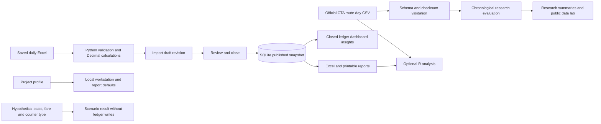

# SmartBus architecture and data dictionary

SmartBus has two separate workflows: local bus revenue reconciliation and a public bus-ridership study. The fictional Tk financial demonstration is not derived from Chicago passenger counts. The application uses Python's standard library, local Excel files and SQLite; R is optional.

## What each technology does

| Technology | Responsibility | What a beginner should inspect |
| --- | --- | --- |
| Excel | Visible trip and counter inputs, master lists, formulas, validations and exported reports | Trace one ticket quantity and fare from the daily workbook to its receipt balance |
| Python | Validate saved inputs, calculate money, preserve revisions, serve the local interface and reproduce research | Follow `calculate()` in `counter_accounting.py`, then the import/review/close methods in `ledger_store.py` |
| SQLite | Store imported revisions, published snapshots, indexed financial records and audit events | Compare a day's current `revision` with its `published_revision` |
| HTML/CSS/JavaScript | Present the local workstation, filters, charts and action forms | Inspect `workstation_ui.py` and its same-origin requests to `control_panel.py` |
| Optional base R | Independently summarize exported CSVs and reproduce the public-ridership comparison | Run `analyze.R` with the documented trip CSV or ridership CSV; it does not write to the ledger |

## Data flow

Excel formulas help the operator work, but Python recomputes financial values from saved inputs rather than trusting cached formula results. Save and close Excel before importing. Import freezes transaction references so later master-list edits cannot reprice those saved transactions.

## Modules and boundaries

| Module | Purpose |
| --- | --- |
| `daily_system.py` | Create daily workbooks, validate records, collect reporting periods and generate printable reports |
| `counter_accounting.py` | Normalize workbook inputs and calculate collection lines, trip/counter groups and trip totals |
| `values.py`, `xlsx_io.py` | Shared date/money parsing and workbook XML reading |
| `ledger_store.py` | Import, review, close, corrections, published revisions, audit history and verified recovery |
| `period_export.py`, `report_layout.py` | Period Excel exports and report presentation from closed records |
| `insights.py` | Read-only closed-record totals, route/counter comparisons and hypothetical single-trip calculations |
| `control_panel.py`, `workstation_ui.py` | Loopback HTTP boundary and dependency-free browser interface |
| `project_profile.py`, `project.json` | Validate and atomically save supported identity, branding and default labels |
| `ridership.py`, `research/` | Download, verify and analyze the official CTA snapshot with provenance files |
| `platform_open.py` | Open a saved file or folder through the operating system |
| `demo.py` | Prepare an isolated fictional demonstration workspace |
| `analyze.R` | Optional independent CSV analysis, plots and research forecast comparison |

## SQLite schema

The database is `data/ledger.sqlite3`, with schema version 1. SQLite foreign-key checks are enabled for application connections. Full calculated books live in `revisions.snapshot_json`; the financial tables contain a smaller indexed projection of those books.

| Table | Primary key | Stored purpose and relationships |
| --- | --- | --- |
| `days` | `day` | One ISO calendar date; current `status`, `revision`, nullable `published_revision`, source workbook name, correction reason and update timestamp |
| `revisions` | `(day, revision)` | Foreign key `day → days.day`; source/snapshot SHA-256 values, full snapshot JSON, import timestamp, operator label and nullable closure timestamp |
| `trips` | `(day, revision, record_id)` | Foreign key `(day, revision) → revisions`; unique `(day, revision, trip_label)`; indexed gross, commission, due, nullable actual and outstanding amounts |
| `settlements` | `(day, revision, trip_record_id, counter)` | Foreign key `(day, revision, trip_record_id) → trips`; due, actual and outstanding for one trip/counter pair |
| `audit_events` | Autoincrement `id` | UTC timestamp, actor, action, optional day/revision and JSON details; day/revision are descriptive references, not declared foreign keys |

`days.revision` and `days.published_revision` are application-managed pointers to revisions for that day; they are not declared composite foreign keys. Trip record IDs are UUIDs reused across revisions when the trip label remains the same.

The stored day states are `draft`, `reviewed` and `closed`. A correction opens a new draft while retaining the prior `published_revision`. The interface may display “correction,” but it is not an additional SQLite status value. Final reports continue to use the previously closed revision until the replacement is reviewed and closed.

Review rejects invalid or orphaned records, trips without linked counter records and counters whose actual receipt is unknown. A known outstanding amount may be closed. An explicitly closed day with no trips differs from a missing day; missing dates are not silently filled with zero activity.

## Financial snapshot dictionary

Money is calculated with `Decimal`. Snapshot serialization preserves Decimal values with tagged JSON objects; indexed SQLite money columns use text. Insights expose monetary amounts as decimal strings and format occupancy separately as a percentage. Do not recalculate money from a chart's approximate screen coordinates.

| Field | Scope | Meaning |
| --- | --- | --- |
| `day`, `trip`, `record_id` | Trip | ISO date, workbook trip label and stable ledger identifier |
| `route`, `direction`, `coach`, `bus` | Trip | Operating references taken from the workbook; not live route or vehicle tracking |
| `start`, `end` | Trip | Departure and arrival values; an arrival may still be pending |
| `driver`, `guide`, `conductor` and their phone fields | Trip | Workbook crew references; use fictional identities in demonstrations |
| `capacity` | Trip | 62 available seats per trip |
| `seats` | Line, counter group, trip | Whole-number tickets sold; trip seats aggregate linked counter groups |
| `fare` | Collection line | Ticket price in Tk |
| `counter`, `kind` | Line, counter group | Counter name and `Own` or `Commission` type |
| `gross` | Line, counter group, trip | Seats multiplied by fare |
| `commission` | Line, counter group, trip | Tk 50 per ticket for Commission counters; zero for Own counters |
| `due` | Line, counter group, trip | Gross revenue minus commission |
| `actual` | Line, counter group, trip | Received deposit; blank/`None` means unknown, while zero is an entered zero receipt |
| `outstanding` | Counter group, trip | `max(due − actual, 0)` per trip/counter group, then summed; an unknown receipt is still flagged as pending |
| `extra_received` | Counter group, trip | `max(actual − due, 0)` per trip/counter group, kept separate from outstanding; insights call this total `extra` |
| `variance` | Counter group, trip | Actual minus due when both are known; it does not replace separate shortage/extra totals |
| `sent_to_office`, `held_cash` | Line/group/trip as applicable | Entered transfer and received cash less transfer; an invalid transfer cannot exceed actual receipts |
| `occupancy` | Trip snapshot | Seats divided by capacity as a fraction; insights expose `occupancy_pct` on a 0–100 scale |
| `pending_counters`, `status`, `issues` | Trip or counter group as applicable | Receipt completeness, reconciliation state and validation messages |

Collection lines are grouped by `(trip, counter)` before reconciliation. A counter group's overpayment never erases another group's shortage; trip and period totals sum their separately calculated balances.

Historical keys such as line `fee`, `net`, `cost` and trip `counter_cost` remain for compatibility: `fee` is the per-ticket commission rate, `net` aliases amount due, and the counter expense fields are zero in the current model. SmartBus does not model operating expenses or establish net profit. The snapshot field `extra_received` is distinct from historical expense-related fields named `extra`.

## Official CTA source dictionary

The public source is [CTA bus-route daily totals from the City of Chicago](https://data.cityofchicago.org/Transportation/CTA-Ridership-Bus-Routes-Daily-Totals-by-Route/jyb9-n7fm). Read `research/source.json` for the actual retrieval time, requested dates, API query URLs, checksum and terms reference. The project's MIT license does not relicense the public dataset.

| CSV field | Validated representation | Meaning |
| --- | --- | --- |
| `route` | Nonempty text, at most 80 characters | CTA bus-route identifier; keep it as text |
| `date` | `YYYY-MM-DD`, optionally an accepted midnight ISO timestamp | Observation date, normalized to an ISO date for analysis |
| `daytype` | `W`, `A` or `U` | Weekday, Saturday, or Sunday/holiday category supplied by CTA |
| `rides` | Nonnegative whole number, at most 1,000,000,000 | Recorded boardings for that route/date; not unique passengers |

The grain is one observed route/date pair. Duplicate pairs are rejected. Missing route-days remain absent. Research input is bounded to 200,000 rows and an inclusive period of at most 366 days; forecasting needs at least 14 observed dates.

The final seven observed dates form the holdout. The model uses the training-period mean for the same route/daytype; the baseline uses each route's last training-period observation. Neither uses holdout ridership as a predictor. Both are scored on the same eligible holdout rows, with exclusions reported. MAE measures average absolute error in rides; a lower number is better. This retrospective comparison does not validate a deployed forecast for another city.

`ridership.py` produces `benchmark.json`, `daily_summary.csv`, `route_summary.csv` and `forecast_predictions.csv`. The local public data lab verifies the raw snapshot's checksum and recomputes its summary rather than trusting an edited benchmark file. No ridership record becomes a financial trip or receipt.

## Customization, planning and trust boundaries

- **Customization:** Eight supported fields cover project name, tagline, author, GitHub username, repository name, company name, default operator and accent color. Company names permit 120 characters and default operators 80; other general text fields permit 160. Accent colors require six-digit hex values. Saving validates the full profile before replacing `project.json`; reload applies it. Branding cannot change commission or capacity rules.
- **Planning:** A scenario accepts hypothetical seats from 0 to 62, fare and counter type. It returns gross, commission, due and occupancy using the fixed model. It creates no workbook, trip, revision or ledger receipt and assumes no operating costs.
- **Browser boundary:** The server binds to loopback, checks Host/Origin, requires the local session token for data/actions, applies request limits and serializes mutations. CSP nonces protect the inline script/style. The interface inserts data as text and serves only eligible report files through its file endpoint.
- **Input boundary:** Saved Excel and downloaded CSV are inputs requiring validation. Workbook formula caches are not authoritative. Source and snapshot checksums detect inconsistency; they are not a digital signature proving who created the data.
- **Publication boundary:** A closed snapshot is authoritative for final figures even if the original workbook changes or disappears. Corrections preserve the old publication until replacement closure. Report exports retain source revision references.
- **Recovery boundary:** Application writers use a process lock; backups and restore verify database/snapshot integrity and retain recovery copies. Ledger backups do not replace separate backups of Excel, reports and project settings.
- **Identity boundary:** Operator labels support attribution, not authenticated identities or separation of duties. Audit update/delete triggers are application protections, not tamper-proof security against someone controlling the database or machine. This is a local workstation, not a public backend or a full accounting system.

For demonstration evidence and honest project claims, continue with [PORTFOLIO_GUIDE.md](PORTFOLIO_GUIDE.md). For courses and practical exercises, use [LEARNING_PATH.md](LEARNING_PATH.md).
