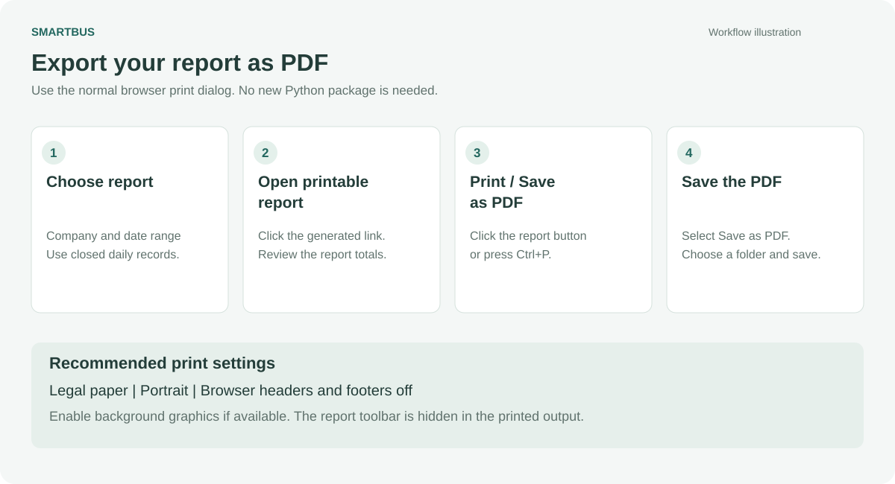

# Export a SmartBus report as PDF

There are three ways to create a PDF. The browser method is the simplest starting point.



## Method 1: printable report from the control panel

1. Save and close the daily Excel workbooks.
2. In **Daily review**, import, review and close each recorded day you want to include.
3. In **Publish a final report**, enter the company and choose **Start** and **End** dates.
4. Click **Open printable report**.
5. Click the **Open report — Print / Save as PDF** link in the result box.
6. Inspect the report, then click **Print / Save as PDF** at the top. **Ctrl+P** also works.
7. In the browser print dialog, select **Save as PDF**. On Windows, **Microsoft Print to PDF** is another destination.
8. Select **Legal** paper, **Portrait**, and the default scale. Turn browser headers and footers off. Enable background graphics if available.
9. Click **Save** or **Print**, choose your folder and filename, and save the PDF.

The report's print toolbar is hidden in the PDF. The saved `.html`, CSV extracts and source manifest remain under `reports/`; the PDF goes to the folder you choose in the print dialog. Creating HTML does not itself mean a PDF has been saved.

### Try it without entering your own transactions

Run:

```text
python demo.py
```

Open the printable-report path shown in the terminal. Or download [the included sample HTML](Demo_Report_en.html) and open the saved file locally in a normal browser. GitHub displays HTML source rather than running the application.

## Method 2: optional automatic PDF

Choose the same company/dates and click **Automatic PDF**. If Microsoft Edge can run its headless print engine, the application saves the PDF under `reports/` and shows an **Open PDF** link.

If this fails, use Method 1. The headless engine can be restricted by the operating environment; a failed automatic export should not require a new ledger import or a change to the numbers.

CLI equivalent:

```text
python daily_system.py report 2026-10-12 2026-10-12 --company "Example Transport"
```

To create printable HTML without launching Edge:

```text
python daily_system.py report 2026-10-12 2026-10-12 --company "Example Transport" --printable
```

## Method 3: export an Excel sheet directly

If you specifically want the workbook's own appearance:

1. Open the daily workbook or the combined Excel report in Excel.
2. Select the sheet to export, such as **Dashboard**.
3. Inspect **Print Preview** and the print area. For wide detail sheets, use **Landscape** and fit columns to one page wide; allow multiple pages vertically.
4. Use **File → Save As** and choose **PDF**, or use **Export → Create PDF/XPS** where available.
5. In export options, choose the active sheet(s) or the entire workbook deliberately.
6. Save and inspect the resulting PDF.

Excel exports the workbook's current saved/calculated view. A final SmartBus printable report exports the accepted closed ledger revision. After an unapproved edit or while a correction is open, those views can intentionally differ. Review and close the replacement revision when you intend the accepted report to change.

## Troubleshooting

| Problem | Action |
| --- | --- |
| No closed records | Import, review and close the relevant daily files. |
| Blank received deposits block review | Enter an explicit `0` if no money was received; otherwise enter the known receipt. |
| PDF destination missing | Look for Microsoft Print to PDF or use a browser that offers Save as PDF. |
| Columns or charts cut off | Use Legal/Portrait for the SmartBus printable layout; use the appropriate landscape print settings for wide Excel sheets. |
| Browser headers duplicate the report | Disable browser headers and footers in print settings. |
| Old values after editing Excel | Use the correction workflow. Final reports deliberately preserve the previous closed revision until replacement closure. |

PDF printing and Excel desktop behavior should be checked in your normal Windows installation. The unit tests verify printable content, data controls and error handling, not the OS print dialog.
